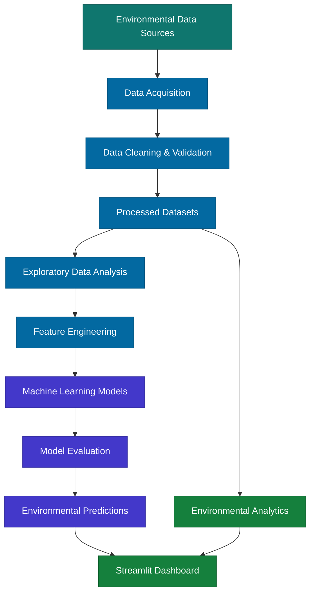

<div align="center">


# SevanEco AI

### AI-Powered Environmental Intelligence for Lake Sevan

**Data for Nature. Intelligence for the Future.**

<br>


<br>


<br><br>

**ENVIRONMENTAL MONITORING · DATA ANALYTICS · MACHINE LEARNING · PREDICTION**

<br>

An AI-powered environmental research and monitoring project designed to analyze ecological changes, explore environmental patterns, and develop data-driven predictions for Lake Sevan, Armenia.

<br>

[**Explore the Project**](#-project-overview) &nbsp;•&nbsp;
[**System Architecture**](#-system-architecture) &nbsp;•&nbsp;
[**Development Roadmap**](#-development-roadmap) &nbsp;•&nbsp;
[**Project Team**](#-project-team)

</div>

---

## 🌍 Project Overview

**SevanEco AI** is an environmental artificial intelligence initiative focused on Lake Sevan, one of Armenia's most important freshwater ecosystems.

The project aims to integrate environmental observations, historical climate records, hydrological measurements, and satellite-derived information into a unified analytical workflow.

Through data science and machine learning, SevanEco AI seeks to support a deeper understanding of environmental trends and develop tools for exploring potential future changes.

The project combines:

- Environmental science and ecological research
- Data engineering and automated preprocessing
- Statistical analysis and visualization
- Machine learning and predictive modeling
- Interactive environmental dashboards

> **Our Mission**
>
> Transform complex environmental information into accessible, scientifically grounded insights that support the sustainable future of Lake Sevan.

---

## 🎯 Project Goals

<table>
<tr>
<td width="50%" valign="top">

### 🌊 Environmental Monitoring

Organize and analyze environmental observations to identify meaningful changes in Lake Sevan's ecosystem.

</td>
<td width="50%" valign="top">

### 📊 Data Intelligence

Integrate environmental datasets and explore historical patterns, relationships, and anomalies.

</td>
</tr>
<tr>
<td valign="top">

### 🧠 Predictive Modeling

Develop and evaluate machine learning models for selected environmental indicators.

</td>
<td valign="top">

### 🖥️ Interactive Visualization

Build an accessible dashboard for environmental exploration, analytics, and prediction results.

</td>
</tr>
</table>

---

## ✨ Planned Key Features

| Feature | Description | Development Stage |
|:---|:---|:---|
| 🌊 Water Quality Analysis | Explore historical water-quality indicators | Planned |
| 🌦️ Climate Data Integration | Analyze meteorological variables and trends | Planned |
| 💧 Hydrological Monitoring | Examine lake and river monitoring data | Planned |
| 🛰️ Satellite Data Exploration | Investigate satellite-derived environmental indicators | Research |
| 📈 Environmental Trend Analysis | Identify patterns and temporal changes | Planned |
| 🧠 AI Prediction Models | Forecast selected environmental variables | Planned |
| 🗺️ Interactive Dashboard | Visualize observations and model results | Planned |
| 🧪 Model Evaluation | Compare baselines and experimental models | Planned |

*Feature availability and scope will be updated as implementation progresses.*

---

## 🏗️ System Architecture

SevanEco AI is designed around a modular, reproducible data science architecture.



### Architecture Principles

**Modularity** — Each component should be independently testable and maintainable.

**Reproducibility** — Data transformations and model experiments should be documented.

**Scalability** — The architecture should support additional environmental datasets and modeling approaches.

**Scientific Transparency** — Data limitations, model assumptions, and evaluation results should be clearly communicated.

---

## 🛰️ Environmental Data Sources

The project investigates multiple environmental data categories.

| Data Category | Potential Source | Intended Application |
|:---|:---|:---|
| Water Quality | Armenian environmental open data | Historical water-quality analysis |
| Hydrology | Armenian hydrological monitoring | Water-level and hydrological trends |
| Climate | Open-Meteo Historical Weather API | Climate features and historical analysis |
| Satellite Data | Microsoft Planetary Computer | Remote sensing exploration |
| Environmental Pressures | Armenian environmental statistics | Environmental context and interpretation |

### Data References

- [Armenian Open Data Portal](https://data.opendata.am/)
- [Historical Weather API — Open-Meteo](https://open-meteo.com/en/docs/historical-weather-api)
- [Microsoft Planetary Computer](https://planetarycomputer.microsoft.com/)

### Data Quality Requirements

Before inclusion in the modeling pipeline, datasets should be evaluated for:

- Source reliability and licensing
- Spatial coverage and geographical relevance
- Temporal coverage and sampling frequency
- Missing values and measurement consistency
- Compatibility with selected prediction targets
- Reproducibility and documentation

---

## 🛠️ Technology Stack

<div align="center">

### Core Development


### Data Science & Machine Learning


### Visualization & Interface


</div>

### Planned Technical Components

| Category | Technologies |
|:---|:---|
| Programming | Python |
| Data Processing | Pandas, NumPy |
| Scientific Computing | SciPy |
| Machine Learning | Scikit-learn |
| Data Visualization | Matplotlib, Plotly |
| Interactive Interface | Streamlit |
| Notebook Environment | Jupyter |
| Automated Testing | Pytest |
| Version Control | Git, GitHub |
| Project Management | Notion |

The technology stack may evolve based on dataset characteristics, experimental results, and available computational resources.

---

## 📁 Repository Structure

```text
SevanEco-AI/
│
├── assets/
│   ├── image.png
│   └── sevaneco-logo.png
│
├── dashboard/
│
├── data/
│   ├── raw/
│   └── processed/
│
├── docs/
│
├── notebooks/
│
├── src/
│
├── tests/
│
├── .gitignore
├── LICENSE
├── README.md
├── config.py
└── requirements.txt
```

### Directory Guide

| Directory | Purpose |
|:---|:---|
| `assets/` | Branding, logo, and project visuals |
| `dashboard/` | Interactive dashboard application |
| `data/raw/` | Original environmental datasets |
| `data/processed/` | Cleaned and transformed datasets |
| `docs/` | Technical and scientific documentation |
| `notebooks/` | Research notebooks and experiments |
| `src/` | Core Python modules and ML components |
| `tests/` | Automated tests and validation |

**Repository Status:** The foundational structure is being established. Empty directories may contain `.gitkeep` placeholders until their implementation files are added.

---

## 🗓️ Development Roadmap

**Project Period: November 2, 2026 – January 31, 2027**

| Phase | Timeline | Focus |
|:---|:---|:---|
| **00 — Preparation** | Nov 2–15, 2026 | Idea development, research, scope, initial roadmap |
| **01 — Research & Planning** | Nov 15–30, 2026 | Validation, technical architecture, requirements |
| **02 — Data Engineering** | Dec 1–15, 2026 | Data acquisition, preprocessing, exploratory analysis |
| **03 — Baseline ML Development** | Dec 13–20, 2026 | Baseline training and initial evaluation |
| **04 — AI & Dashboard Development** | Dec 21, 2026 – Jan 15, 2027 | Model improvements, interface, integration |
| **05 — Testing & Delivery** | Jan 16–31, 2027 | QA, documentation, poster, pitch, final demonstration |

### Development Milestones

- [ ] Idea Validation Canvas and research documentation
- [ ] Technical implementation plan
- [ ] Validated environmental datasets
- [ ] Data preprocessing pipeline
- [ ] Exploratory data analysis
- [ ] Baseline machine learning model
- [ ] Quantitative model evaluation
- [ ] Interactive Streamlit dashboard
- [ ] Integrated environmental analytics
- [ ] Automated testing and quality assurance
- [ ] Science fair poster
- [ ] Final presentation and project demonstration

*Milestone checkboxes are updated as deliverables are completed and verified.*

---

## 🚀 Getting Started

### Prerequisites

- Python 3.x
- Git
- pip

### 1. Clone the Repository

```bash
git clone https://github.com/Tig-Khach/SevanEco-AI.git
cd SevanEco-AI
```

### 2. Create a Virtual Environment

```bash
python -m venv .venv
```

### 3. Activate the Environment

**Windows PowerShell**

```powershell
.venv\Scripts\Activate.ps1
```

**Windows Command Prompt**

```cmd
.venv\Scripts\activate.bat
```

**macOS / Linux**

```bash
source .venv/bin/activate
```

### 4. Install Dependencies

```bash
python -m pip install --upgrade pip
python -m pip install -r requirements.txt
```

### 5. Run Tests

Once the test suite is implemented:

```bash
python -m pytest
```

### Dashboard

The interactive dashboard is under development. Launch instructions will be added when a working application is available.

---

## 🧪 Machine Learning Strategy

The project follows a structured experimental approach.

### Stage 1 — Exploratory Analysis

Understand the characteristics of available environmental datasets.

### Stage 2 — Baseline Models

Develop simple, interpretable prediction baselines.

### Stage 3 — Feature Engineering

Investigate environmental predictors, temporal features, and relevant relationships.

### Stage 4 — Advanced Modeling

Evaluate more sophisticated approaches when supported by the available data.

### Stage 5 — Model Validation

Compare model performance on appropriate evaluation datasets.

### Planned Evaluation Metrics

| Metric | Purpose |
|:---|:---|
| MAE | Average absolute prediction error |
| RMSE | Penalizes larger prediction errors |
| R² | Measures explained variance |
| Temporal Validation | Tests generalization to later observations |
| Error Analysis | Identifies model weaknesses and limitations |

**Scientific Note:** No predictive accuracy claims will be made before validated experiments are completed.

---

## 👥 Project Team

<div align="center">

### Four People. One Mission.

*Combining artificial intelligence, environmental science, data engineering, and research.*

</div>

| Team Member | Position | Responsibility |
|:---|:---|:---|
| **Tigran Khachatryan** | AI Project Lead & Technical Coordinator | Architecture, coordination, integration |
| **Hayk Matevosyan** | Machine Learning Research Engineer | ML research, modeling, evaluation |
| **Vahe Zakaryan** | Data Engineer & Interface Developer | Data processing, pipelines, dashboard |
| **Anahit Yeghiazaryan** | Scientific Researcher & QA Lead | Research, testing, documentation |

### Team Workflow

The team follows a collaborative development process based on task ownership, version control, and documented progress.

- Notion — planning, responsibilities, and milestone tracking
- GitHub — code management, collaboration, and version history
- Pull Requests — review and integration of changes
- Documentation — research evidence and technical decisions

---

## 🤝 Contributing

Contributions should follow a structured workflow:

1. Create a dedicated feature branch.
2. Implement the assigned functionality.
3. Add or update relevant tests.
4. Commit changes with descriptive messages.
5. Open a pull request.
6. Review and merge approved changes.

### Branch Naming Examples

```text
feature/data-acquisition
feature/preprocessing
feature/baseline-ml
feature/dashboard
docs/research
test/data-validation
```

### Commit Message Examples

```text
Add environmental data acquisition module
Implement initial preprocessing pipeline
Create baseline regression experiment
Add Streamlit dashboard layout
Update dataset documentation
```

---

## 🔬 Scientific Integrity & Responsible AI

SevanEco AI is designed around responsible scientific practices.

**Transparency:** Document environmental data sources and processing steps.

**Reproducibility:** Maintain clear experiment configurations and evaluation procedures.

**Reliability:** Validate data quality and model outputs.

**Uncertainty:** Communicate limitations and prediction uncertainty.

**Environmental Responsibility:** Avoid unsupported ecological conclusions.

> AI predictions are research outputs and should not be interpreted as official environmental measurements or definitive ecological assessments.

---

## 📚 Documentation

Project documentation is organized within the `docs/` directory.

Planned documentation includes:

- Project concept and problem definition
- Idea Validation Canvas
- Research questions and hypotheses
- Data source inventory and Data Cards
- Implementation plan
- System architecture
- Machine learning experiments
- Testing and quality assurance
- Final presentation materials

---

## 📄 License

This project is licensed under the **MIT License**.

See the [LICENSE](LICENSE) file for more information.

---

<div align="center">


### SevanEco AI

**Data for Nature. Intelligence for the Future.**

*Environmental Intelligence for a Sustainable Tomorrow.*

**Lake Sevan · Armenia**

<br>


</div>
