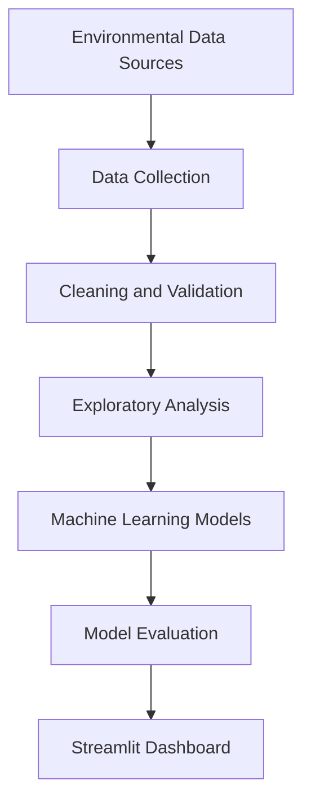

<div align="center">

# 🌊 SevanEco AI

### AI-Powered Environmental Intelligence for Lake Sevan

**Monitoring · Analytics · Prediction**


**An AI-driven environmental research project focused on Lake Sevan, Armenia.**

</div>

---

## 🌍 Overview

**SevanEco AI** aims to combine environmental datasets,
machine learning, and interactive visualization to study
ecological changes in Lake Sevan.

The project is being developed as an AI capstone project.

### Our Mission

> Transform environmental data into meaningful insights
> that support scientific research and informed decisions.

---

## 🎯 Project Objectives

- Collect and validate environmental datasets.
- Analyze historical water-quality and climate trends.
- Develop and evaluate machine learning models.
- Investigate environmental forecasting approaches.
- Build an interactive environmental dashboard.
- Document model uncertainty and limitations.

---

## 🧠 System Architecture



*Proposed architecture — implementation in progress.*

---

## 🛠️ Technology Stack

| Category | Technologies |
|---|---|
| Language | Python |
| Data Processing | Pandas, NumPy |
| Machine Learning | Scikit-learn |
| Scientific Analysis | SciPy, Xarray |
| Geospatial Data | Rasterio |
| Visualization | Matplotlib, Plotly |
| Dashboard | Streamlit |
| Testing | Pytest |
| Version Control | Git & GitHub |

*The technology stack may evolve during development.*

---

## 📂 Repository Structure

```text
SevanEco-AI/
├── dashboard/
├── data/
│   ├── raw/
│   └── processed/
├── docs/
├── notebooks/
├── src/
│   ├── preprocessing/
│   ├── models/
│   ├── training/
│   └── evaluation/
├── tests/
├── config.py
├── requirements.txt
├── README.md
└── LICENSE
```

---

## 📊 Development Roadmap

| Phase | Timeline | Focus |
|---|---|---|
| Phase 0 | Nov 2–15, 2026 | Planning |
| Phase 1 | Nov 15–30, 2026 | Research & Setup |
| Phase 2 | Dec 1–20, 2026 | Data & Baseline MVP |
| Phase 3 | Dec 21 – Jan 15 | AI Development |
| Phase 4 | Jan 16–31, 2027 | Testing & Delivery |

---

## 🚀 Getting Started

### 1. Clone the repository

```bash
git clone https://github.com/Tig-Khach/SevanEco-AI.git
cd SevanEco-AI
```

### 2. Create a virtual environment

```bash
python -m venv .venv
```

Activate it:

**Windows**
```bash
.venv\Scripts\activate
```

**macOS / Linux**
```bash
source .venv/bin/activate
```

### 3. Install dependencies

```bash
pip install -r requirements.txt
```

Application launch instructions will be added once
the dashboard is implemented.

---

## 👥 Project Team

| Team Member | Responsibility |
|---|---|
| Tigran Khachatryan | AI Project Lead & Technical Coordinator |
| Hayk Matevosyan | Machine Learning Research Engineer |
| Vahe Zakaryan | Data Engineer & Interface Developer |
| Anahit Yeghiazaryan | Scientific Researcher & QA Lead |

---

## 🔬 Research Principles

- Transparent data provenance
- Reproducible experiments
- Quantitative model evaluation
- Responsible AI practices
- Clear documentation of limitations

Predictions are intended for research support and should
not replace official environmental assessments.

---

## 📄 License

This project is licensed under the MIT License.
See [LICENSE](LICENSE).

---

<div align="center">

### 🌊 SevanEco AI

**Data for Nature. Intelligence for the Future.**

Made with dedication to Lake Sevan, Armenia.

</div>
